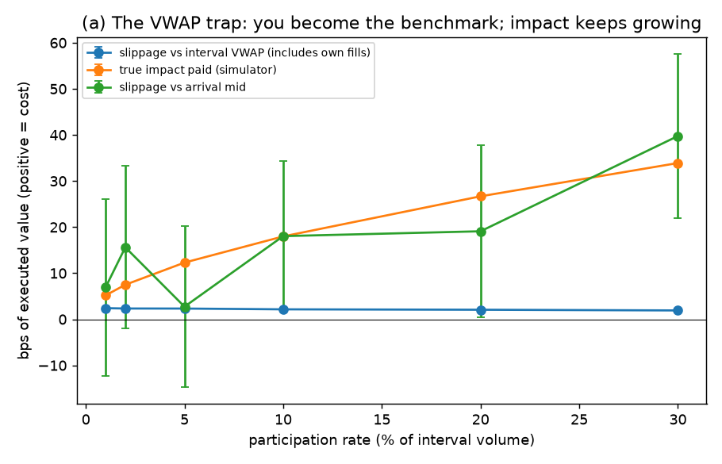
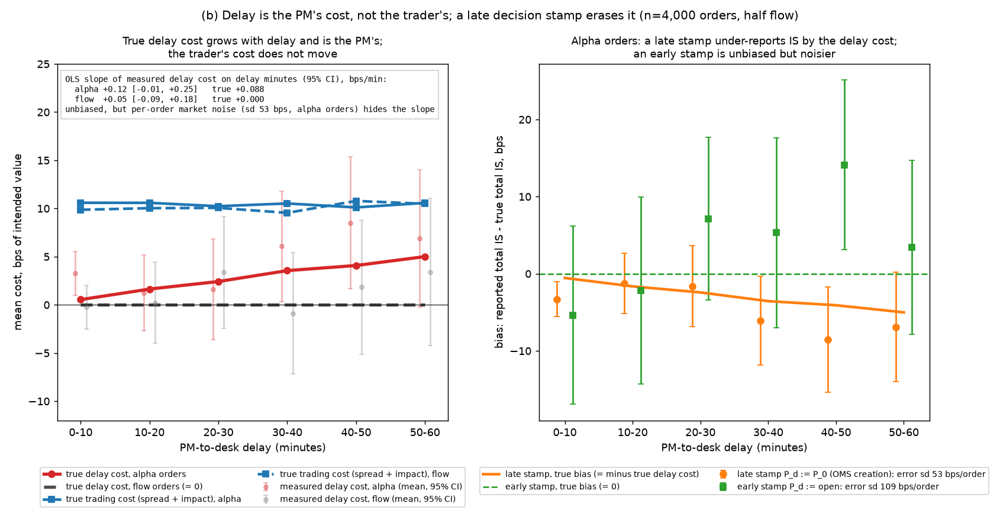
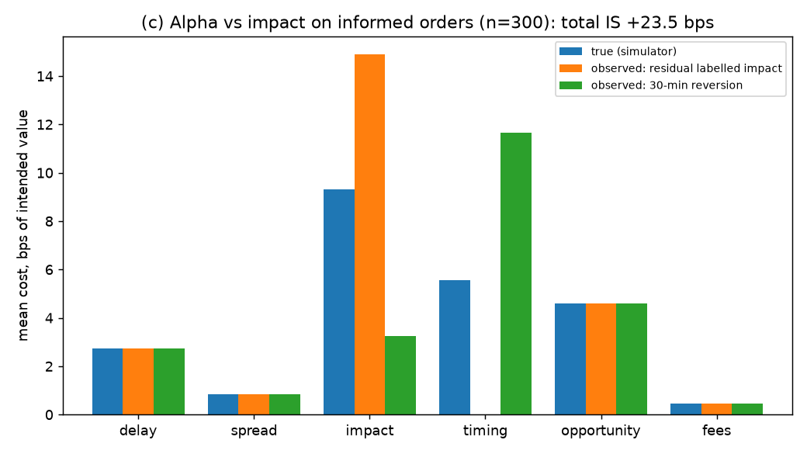
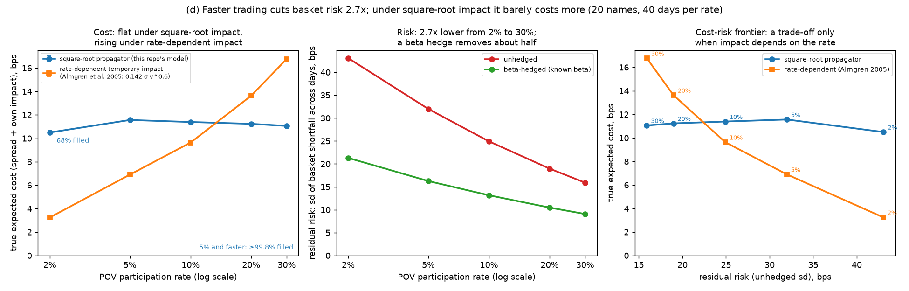
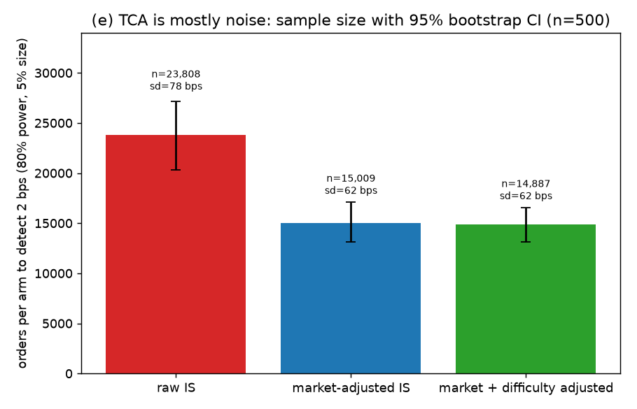

# tca-groundtruth

**Post-trade transaction cost analysis (TCA) where the right answer is known.**

All data in this repository is synthetic; model parameters come from the cited published
papers or are stated as assumptions; nothing here is proprietary to any employer.
Next step: [impact-lab](https://github.com/zhuanyi/impact-lab) calibrates an impact model on
this simulator's orders and carries the calibration error into strategy capacity.

## The question

Every TCA report labels a column "market impact" and ranks desks by slippage
against a benchmark. On real data nobody can check those numbers, because the
price path the order *did not* cause is never observed. This repo builds a
small simulator that records that counterfactual path, so every estimate a TCA
system produces can be set next to the truth and the bias measured.

## Headline chart



Zero-alpha orders executed at a fixed participation rate. Slippage against the
interval VWAP (which includes the order's own fills, as every real VWAP does)
stays flat at about 2 bps from 1% to 30% participation, while the impact the
order actually paid rises from 5 to 34 bps. VWAP measures whether the algo
tracked the volume curve. It does not measure cost.

## Three findings (fixed seed `20261028`, numbers from `reports/summary.csv`)

1. **VWAP slippage does not measure cost.** Raising participation from 1% to 30% moves
   slippage against the interval VWAP from 2.4 to 1.9 bps while the impact actually paid rises
   from 5.2 to 33.9 bps: the benchmark includes the order's own fills and moves with it.
2. **Alpha is mistaken for impact, in both directions.** On informed orders with a true impact
   of 9.3 bps, labelling the residual of trading cost as impact reports 14.9 bps (+60%); a
   30-minute reversion estimator reports 3.2 bps (-65%).
3. **TCA is mostly noise.** Implementation shortfall has a per-order sd of 78 bps (62 bps
   market-adjusted), so telling two brokers apart by 2 bps at 80% power takes about 23,800
   orders per arm (15,000 market-adjusted).

### All five charts

| | Finding | Numbers |
|---|---|---|
| (a) | **The VWAP trap.** Slippage vs interval VWAP is insensitive to impact because the benchmark moves with the order. | VWAP slippage 2.4 bps at 1% participation, 1.9 bps at 30%; true impact 5.2 bps and 33.9 bps. |
| (b) | **Delay belongs to the PM, and a late decision stamp makes it disappear.** The alpha that leaks away between the PM's decision and the desk's arrival is the investment process's cost; the trader's cost (spread + impact) does not depend on the delay. The chart plots the true delay cost, which only the simulator knows, as the main line and the measured delay cost faintly behind it: market moves during the delay (sd 53 bps per order) swamp a 0.5 to 5 bps signal, so the measured estimate is unbiased but cannot resolve the slope even at 4,000 orders. Stamping the decision at order creation in the OMS (`P_d := P_0`) sets delay to zero and under-reports IS by exactly the delay cost; an earlier stamp (the open) is unbiased but twice as noisy. | 4,000 orders, half of them flow. True delay cost on informed orders: 0.5 bps at 0-10 min rising to 5.0 bps at 50-60 min (slope +0.088 bps/min), 3.0 bps on average, 18% of their 16.9 bps total IS; exactly 0 on flow orders. Measured slope +0.12 bps/min (95% CI -0.01 to +0.25) on informed orders, +0.05 (-0.09 to +0.18) on flow orders. True trading cost (spread + impact) 9.5 to 10.8 bps in every bucket for both order types. Late stamp on informed orders: mean bias -4.8 ± 2.3 bps (95% CI; expected -3.0), error sd 53 bps per order. Early stamp: mean bias +4.0 ± 4.7 bps (covers 0), error sd 109 bps per order, against a true-IS sd of 79 bps. |
| (c) | **Alpha is mistaken for impact, in both directions.** On informed orders, labelling the residual of trading cost as impact overstates it; a 30-minute reversion estimator understates it because the alpha keeps realising and suppresses the reversion. | True impact 9.3 bps. Residual method 14.9 bps (+60%). Reversion method 3.2 bps (-65%). True timing (alpha realising during the order) 5.6 bps. Total IS 23.5 bps. |
| (d) | **Speed buys risk reduction; under the square-root law it costs almost nothing, under rate-dependent impact it does.** A fixed 20-name basket (70% buys) traded by POV from minute 30 to the close, 40 market days shared by every speed. Faster schedules cut residual risk (the sd of basket shortfall across days) 2.7x, and a beta hedge removes about half of what is left. With the repo's propagator (`delta + beta_kernel = 1`) a completed order's impact barely depends on its rate, so the true expected cost is flat and there is no cost-risk trade-off to optimise: only the slowest rate, which leaves a third of the shares unfilled, is cheaper. Swapping in a rate-dependent temporary impact (Almgren et al. 2005, `0.142 sigma (n/v)^0.6`, an option on `ImpactParams`, off by default) brings back the classic frontier: cost rises five-fold with speed. | POV 2% to 30%: unhedged risk 43 to 16 bps, beta-hedged 21 to 9 bps. Square-root propagator: true expected cost 10.5 bps at 2% (68% filled), 11.6 at 5%, 11.1 at 30% (5% and faster fill at least 99.8%). Almgren 2005 temporary impact: 3.2 bps at 2%, 6.9 at 5%, 9.6 at 10%, 13.6 at 20%, 16.8 at 30%. Cost standard errors under 0.03 bps; risk is the same under both models to 0.1 bps. |
| (e) | **TCA is mostly noise.** The per-order standard deviation of implementation shortfall is tens of bps, so separating two brokers or algos by 2 bps takes tens of thousands of orders per arm. A beta adjustment with matched windows removes a third of the sample size; a pre-trade difficulty adjustment adds almost nothing here because impact variance is small next to timing noise. | sd 78 bps raw, 62 bps market-adjusted. Orders per arm for 2 bps at 80% power: 23,800 raw (95% CI 20,300 to 27,200), 15,000 market-adjusted, 14,900 with difficulty adjustment. |






## Method

- **Market** (`market.py`): 390 one-minute bars; driftless log random walk with a
  U-shaped intraday volatility profile; U-shaped volume with log-normal noise;
  quoted spread narrowing linearly from 10 bps at the open to 4 bps at the
  close; one-factor index model so a beta adjustment is possible. A correlated
  universe generator (one shared index path, per-name betas) drives the
  20-name basket in chart (d).
- **Orders** (`orders.py`): PM parent orders sized log-uniformly between 0.5% and
  10% of daily volume; a decaying alpha drift (5 to 30 bps, half-life 30 to 240
  minutes) added to the no-trade path from the decision minute; a uniform 0 to
  60 minute PM-to-desk delay; 30% of orders flagged `flow` with zero alpha.
- **Execution** (`execution.py`): VWAP, TWAP and POV child schedules; a
  propagator impact model on child orders with transient kernel
  `G(l) = (1 + l)^-0.5` and child impact `(Y/2) sigma_min (n/v)^0.5`, which makes
  a constant-rate metaorder peak at `Y sigma_day sqrt(Q/V_day)`, the square-root
  law, on Gatheral's no-arbitrage boundary; plus a linear permanent part whose
  slope the TCA layer never sees. Passive fills earn the half spread but fill
  with probability 0.9 when the next minute moves against the order and 0.3
  otherwise (adverse selection). Hard end times leave shares unfilled.
- **TCA** (`tca.py`): signed bps, positive = cost. Benchmarks: decision mid,
  arrival mid, interval VWAP including own fills, close, and post-trade moves at
  +5, +30 minutes and close. Perold implementation shortfall on the full
  intended quantity, split into delay (charged on `Q`), spread, impact, timing,
  opportunity cost of unfilled shares and fees; a hypothesis property test
  checks the six components sum to Perold's total on every order. The true split
  uses the simulator's counterfactual; two "observed" splits reproduce what a
  TCA system without it would report. Market-adjusted IS subtracts the
  beta-implied move of the intended position, with each executed share carrying
  the index move from decision to its fill minute and each unfilled share the
  move to the close. Beta is the simulator's index beta, taken as known; in
  practice it is an estimate and a choice (index, sector or factor model).
  A wrong decision stamp is modelled by replacing `P_d` (`decision_price`),
  which changes only delay and the bps denominator.
- **Report** (`report.py`): `make report` rebuilds the five charts and
  `reports/summary.csv` from the fixed seed in about a minute and a half
  (98 s on the development machine). Each
  chart draws from its own generator seeded from the fixed seed. Chart (d)
  uses the same market days for every speed (common random numbers) and reports
  as cost the shortfall net of the no-trade move of the position, which only the
  simulator can compute; the realised mean shortfall over 40 days carries
  several bps of market noise, while the cost mean has a standard error under
  0.03 bps. Chart (d) also reruns the same days with
  `ImpactParams(temporary="almgren2005")`: temporary impact
  `eta * sigma_day * (n/v)^beta_temp` hits only the minute it is traded in,
  with Almgren et al.'s `eta = 0.142`, `beta_temp = 0.6`; the permanent part is
  unchanged. Chart (b) plots the simulator's true delay cost (the alpha that
  realised during the delay) and true trading cost (spread + impact, free of
  market noise) as the main lines, with the measured means behind them.

### Sign conventions

Costs are positive = paid, the academic implementation-shortfall convention
(Perold 1988, Almgren-Chriss 2000, Kissell 2013); every decomposition, chart and
test uses it. `tca_row` also reports a performance view: each `*_perf_bps`
column (`tcost_perf_bps` for the total, `<component>_perf_bps` for the true IS
components, `<bench>_perf_bps` for each benchmark slippage) is exactly minus its
cost, positive = beat the benchmark, the convention used by common industry TCA
platforms. It adds onto alpha (both in bps, positive = gain):
`net alpha = gross alpha + tcost_perf_bps`.

### Parameter sources

| Parameter | Value used | Source |
|---|---|---|
| Square-root prefactor `Y` | 0.5 | Tóth et al. (2011): "The numerical constant Y is of order unity." |
| Child impact exponent `delta` | 0.5 | Tóth et al. (2011): delta ≈ 0.5 on small-tick futures, ≈ 0.6 on large-tick; across studies "delta in the range 0.4 to 0.7". |
| Temporary-impact concavity (context) | – | Almgren, Thum, Hauptmann & Li (2005): temporary exponent 0.600 ± 0.038; "the square-root model β = 1/2 is rejected" at 95%. We keep 0.5 for the square-root law and note the disagreement. |
| Rate-dependent temporary impact (chart (d) comparison only) | `eta` 0.142, exponent 0.6 | Almgren et al. (2005), Section 4.3: "η = 0.142 ± 0.0062", with temporary cost `K = η σ (X / VT)^(3/5)`; σ daily volatility, `X / VT` the participation rate. Applied here per minute, to the child's share of that minute's volume. |
| Permanent impact linear in size | linear, slope 0.3 | Almgren et al. (2005): permanent exponent 0.891 ± 0.10, "α = 1, for linear permanent impact, cannot reliably be rejected." The slope 0.3 is our choice, not the paper's coefficient (unverified). |
| Kernel exponent `beta_kernel` | 0.5 | Chosen so that `delta + beta_kernel = 1`, the no-dynamic-arbitrage boundary in Gatheral (2010) for power-law impact and kernel (condition quoted from secondary notes; unverified against the paper). Propagator form after Bouchaud, Bonart, Donier & Gould (2018). |
| Reversion after the metaorder | not imposed | Bacry et al. (2015) and Zarinelli et al. (2015) report partial reversion of roughly two thirds (figure unverified); the simulator's reversion follows from the kernel and the permanent slope instead. |
| IS decomposition | – | Perold (1988); expanded split after Wagner & Edwards (1993) and Kissell (2013). |
| Daily vol 2%, spread 10 to 4 bps, U-shape ratio 2, alpha 5 to 30 bps, delay 0 to 60 min | – | Assumptions, not paper values. |

## Why synthetic

A simulator knows three things real data never gives you: the price path the
order did not affect, the true impact parameters, and the true alpha. That is
exactly what is needed to test whether an estimator works. The estimators here
are unbiased only under the generating assumptions; the point of the charts is
to show what breaks when the assumptions are not met (alpha in the flow, own
fills in the benchmark, a wrong decision stamp).

## Limitations

- Single-day orders; the basket in chart (d) is the only multi-name layer and
  trades every name with the same POV rate. No overnight, no auctions, no
  optimal (Almgren-Chriss) schedules: the frontier in (d) is traced by POV
  rates, not optimised. Its nearly flat cost axis is a property of the
  `delta + beta_kernel = 1` propagator; the rate-dependent Almgren et al.
  (2005) variant shown next to it is a comparison only and is not used by the
  other charts.
- Schedulers see the day's realised volume (a perfect volume forecast), which
  flatters VWAP and POV tracking.
- Passive fills are a probability model, not a queue model.
- The permanent part of impact is linear in size and never decays; the
  transient part is a power-law propagator. Real metaorder decay is slower and
  its plateau is debated.
- Parameter values in the table above are chosen to sit inside published ranges; they are
  not fitted to any market.
- Parameter validation: market, order and fill parameters are range-checked;
  out-of-range values raise rather than producing NaN.

## Run it

```
python -m venv .venv && .venv/bin/pip install -e ".[dev]"
make lint      # ruff check .
make test      # pytest -q
make report    # rebuilds reports/ from the fixed seed
```

## References

- Almgren, R. and Chriss, N. (2000). "Optimal Execution of Portfolio Transactions." *Journal of Risk* 3(2), 5-39.
- Almgren, R., Thum, C., Hauptmann, E. and Li, H. (2005). "Direct Estimation of Equity Market Impact." *Risk*, July 2005.
- Bacry, E., Iuga, A., Lasnier, M. and Lehalle, C.-A. (2015). "Market Impacts and the Life Cycle of Investors Orders." *Market Microstructure and Liquidity* 1(2).
- Bouchaud, J.-P., Bonart, J., Donier, J. and Gould, M. (2018). *Trades, Quotes and Prices.* Cambridge University Press.
- Gatheral, J. (2010). "No-Dynamic-Arbitrage and Market Impact." *Quantitative Finance* 10(7), 749-759.
- Perold, A. F. (1988). "The Implementation Shortfall: Paper versus Reality." *Journal of Portfolio Management* 14(3), 4-9.
- Kissell, R. (2013). *The Science of Algorithmic Trading and Portfolio Management.* Academic Press.
- Tóth, B., Lempérière, Y., Deremble, C., de Lataillade, J., Kockelkoren, J. and Bouchaud, J.-P. (2011). "Anomalous Price Impact and the Critical Nature of Liquidity in Financial Markets." *Physical Review X* 1, 021006.
- Wagner, W. H. and Edwards, M. (1993). "Best Execution." *Financial Analysts Journal* 49(1), 65-71.
- Zarinelli, E., Treccani, M., Farmer, J. D. and Lillo, F. (2015). "Beyond the Square Root: Evidence for Logarithmic Dependence of Market Impact on Size and Participation Rate." *Market Microstructure and Liquidity* 1(2).
